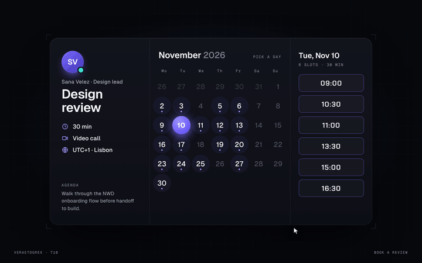

# Slot Booking

**Pick a day, pick a slot, done.**



**Live demo:** [veraetogrex-portfolio.github.io/slot-booking](https://veraetogrex-portfolio.github.io/slot-booking/) · **Mockup:** [full-screen version](https://veraetogrex-portfolio.github.io/slot-booking/mockup/slot-booking.html)

Pick a day and the disc flies to it on an arc while the slots cascade in. Pick a slot and it splits to reveal Confirm. Confirm and the widget folds into an Ion “Booked” card.

## Use it

Three files, no build step, no dependencies, no web fonts:

```
index.html   markup
style.css    styles and keyframes
script.js    behaviour
```

Download the repo and open `index.html`, or copy the three files into your project.

## Try it

- Click a day, a slot, then Confirm.
- “Book another” brings you back.

## Make it yours

`slotsFor(day)` in `script.js` returns fake slots. Replace it with your availability API. Colours are CSS custom properties at the top of `style.css`.

`prefers-reduced-motion` is respected: heavy motion drops to short fades.

## What's in `mockup/`

The full 1440×900 screen this component was shot in for the reel:

- `mockup/slot-booking.html` — interactive. `D` plays the demo, `R` resets.
- `mockup/slot-booking.autoplay.html` — the scripted ~6 s loop with a drawn cursor.
- URL flags: `?frame` puts the screen in a browser window, `?clean` hides the control panel, `?once` plays the demo once.

The mockup uses a shared stage runtime and bundled fonts from `mockup/_shared/`. The component in the root doesn't need any of it.

---

Component 10 of a series. New one every day on Instagram [@veraetogrex_portfolio](https://www.instagram.com/veraetogrex_portfolio/) · all components: [github.com/veraetogrex-portfolio](https://github.com/veraetogrex-portfolio)

MIT licensed.
